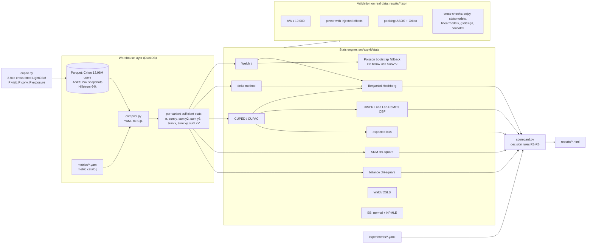

# expkit — an experimentation analysis platform, validated on real randomized experiments

A small version of what a central experimentation team ships (Microsoft ExP, Netflix XP, Eppo,
Statsig): a **SQL metric layer**, a **stats engine**, an **automated scorecard with an explicit
ship/no-ship framework**, and, most importantly, a **validation suite run on real RCT data**.
The suite checks that the engine's error rates are what it claims.

**Business problem.** A large consumer company runs hundreds of A/B tests a quarter. Analysts
hand-roll t-tests, peek at results daily, ignore sample-ratio mismatch, report noisy "winners" at face
value and dilute ad effects across users who never saw the ad. Each of these produces wrong ship
decisions. This repo builds the engine that makes those mistakes hard to make, and **measures** on real
data how often each mistake would have happened.

## Headline results (all real numbers, reproduced by `make all`)

| Question | Answer | Source |
|---|---|---|
| Are the tests calibrated on real data? | A/A on 2,096,937 real Criteo control users × 10,000 re-randomizations: false-positive rate 4.6%–5.0% for Welch, CUPED, CUPAC (visit, conversion) and the delta-method ratio; p-values uniform (min KS p = 0.23) | `results/aa_tests.json` |
| How much does variance reduction buy? | CUPAC cuts variance **30.8%** on visits (CUPED on raw features: 25.2%) and **12.9%** on conversions (CUPED 10.7%), i.e. the same power with 31% / 13% fewer users or days | `results/scorecard_criteo.json` |
| How bad is daily peeking? | On null paths built on the **real look schedules of 361 ASOS experiment trajectories**, naive daily peeking has a **21.7%** false-positive rate (nominal 5%). O'Brien–Fleming: 5.0%. mSPRT: 1.1% | `results/asos_portfolio.json` |
| …on the real trajectories? | Naive peeking declared 218 of 361 real trajectories significant at some point; **116 (32%)** were not supported by the final analysis (OBF: 41, mSPRT: 35). OBF still caught 94% of the final-significant effects, stopping at a median of day 19 of 45 | same |
| Are the "winners" overstated? | Empirical-Bayes deconvolution across the 99 ASOS treatments: significant winners are overstated by **×1.06–×1.21**; the true-effect distribution is fat-tailed (excess kurtosis 5–8); FDR among winners 1–5% | same |
| Real ad incrementality, per exposed user? | Only **3.6%** of assigned users were exposed. ITT on visits +1.03 pp → CACE (Wald) +28.7 pp per exposed user; covariate-adjusted 2SLS +18.3 pp. An ideal ghost-ads trigger would need **7.0× fewer users** to detect the visit effect | `results/noncompliance.json` |
| A data-quality trap the dataset's own check missed | Global SRM passes (split = 0.85000), but a full-scale classifier two-sample test finds T is predictable from features (AUC PENDING, z ≈ PENDING). Raw lift +27.1% vs feature-adjusted +16.6% to +18.3% (CUPAC, CUPED, post-stratification agree) | `results/hte.json`, `results/balance.json` |
| Targeting | PENDING | `results/hte.json` |
| Heavy tails (Hillstrom spend) | Capping at p95 of buyer spend: −14% variance, −3.6% bias, lowest MSE; p90 cap raises power 73% → 82% at −11% bias | `results/heavy_tails.json` |

Acceptance criteria were written **before** building and are scored mechanically: see
[`docs/ACCEPTANCE.md`](docs/ACCEPTANCE.md) (PASS/FAIL with evidence, including the misses).
One-page decision memo for a PM/VP: [`docs/decision_memo.md`](docs/decision_memo.md).

## Architecture



Package map: `src/expkit/metrics` (catalog + SQL compiler) · `stats` (estimators) · `validation`
(A/A, power, peeking, cross-checks, acceptance) · `analyses` (CUPAC, ASOS portfolio, non-compliance,
heavy tails, HTE, balance, figures) · `hte` (T-/X-learner, Qini) · `report` (scorecard + HTML) ·
`decision.py` (rules) · `cli.py`.

## Data (all real, public)

| Dataset | What it is | Rows (verified) | Link | License |
|---|---|---|---|---|
| Criteo Uplift v2.1 | Real randomized ad-incrementality tests: features f0–f11, `treatment` (assignment, 85%), `exposure` (ad actually shown), `visit`, `conversion` | 13,979,592 | [HF Hub `criteo/criteo-uplift`](https://huggingface.co/datasets/criteo/criteo-uplift); paper [Diemert et al. 2021](https://arxiv.org/abs/2111.10106) | CC BY-NC-SA 4.0 |
| ASOS Digital Experiments | 78 real online experiments, 99 treatments, 4 metrics, 12-hourly cumulative (n, mean, variance) per arm | 24,153 | [OSF 64jsb](https://osf.io/64jsb/) via `api.osf.io/v2/nodes/64jsb/files/osfstorage/`; Liu et al. 2021 | CC BY 4.0 |
| Hillstrom MineThatData | Email RCT (men's / women's email / none); spend | 64,000 | [minethatdata.com](http://www.minethatdata.com/blog/2008/03/minethatdata-e-mail-analytics-and-data.html) | public challenge data, no explicit license |

Disk: 0.35 GB processed (the 311 MB Criteo CSV is deleted after conversion to zstd Parquet).
Simulation is used **only** for validation (re-randomizing real units, injecting a known effect, or
null paths on real look schedules) and is labeled `SIMULATION` in every output.

## How to run

```bash
make all          # setup → download → CUPAC → lint → tests → validation → readouts → figures → acceptance
# or step by step
make setup data cupac
.venv/bin/expkit analyze --config experiments/criteo.yaml        # → reports/criteo_readout.html
.venv/bin/expkit analyze --config experiments/criteo_srm_bug.yaml # simulated logging bug → BLOCKED
.venv/bin/expkit validate aa        # or: crosscheck | asos | noncompliance | heavy | hte | balance
.venv/bin/expkit acceptance         # regenerates the PASS/FAIL table in docs/ACCEPTANCE.md
```

Python 3.12 (uv), pinned in `pyproject.toml`. `Dockerfile` and `.github/workflows/ci.yml` are provided
(not built or run here: no Docker daemon available, and the repo is local-only).

## Results

### 1. The engine is correct (external referees)

| Check (real Criteo data unless noted) | Result |
|---|---|
| Welch from SQL sufficient stats vs `scipy.stats.ttest_ind` (13.98M rows) | max rel. diff 4e-16 |
| Delta-method ratio SE vs `statsmodels` cluster-robust OLS | rel. diff 8e-15 |
| CUPED (SQL, 12 covariates) vs statsmodels θ + scipy Welch on adjusted values (2.0M users) | 7e-9; vs ANCOVA HC1: estimate within 0.04% |
| Wald CACE and SE vs `linearmodels` IV2SLS (robust), 13.98M rows | 8e-11 / 9e-12 |
| Lan–DeMets OBF boundaries vs independent `gsdesign` integration; Jennison–Turnbull constants | ≤ 1e-6; Pocock 2.413 / OBF 2.040 reproduce α = 0.050 |
| mSPRT Λ vs numerical integration of the mixture likelihood | ≤ 1e-6 |
| Own Qini curve vs `causalml.metrics.get_qini` | PENDING |

### 2. Calibration and power on real units (simulation on real data)


Power: PENDING

### 3. Peeking — ASOS real trajectories


| method | null FPR (real ASOS look schedules) | declared on real trajectories | not supported by final | detects final-significant | median stop day |
|---|---|---|---|---|---|
| naive daily p < 0.05 | 21.7% | 218 / 361 | 116 | 97% | 9 |
| O'Brien–Fleming (Lan–DeMets) | 5.0% | 140 | 41 | 94% | 19 |
| mSPRT (τ = portfolio prior sd) | 1.1% | 104 | 35 | 66% | 12 |

Criteo control users, random arrival order, PENDING.

### 4. Winner's curse — ASOS as a company's experiment portfolio


| metric | treatments | sig. winners | mean observed lift of winners | EB (NPMLE) posterior | overstatement | FDR among winners (NPMLE) | P(true lift > +0.1%) | prior excess kurtosis |
|---|---|---|---|---|---|---|---|---|
| 1 | 99 | 16 | +0.99% | +0.91% | ×1.09 | 4.4% | 23% | 8.2 |
| 2 | 94 | 12 | +1.63% | +1.53% | ×1.06 | 4.5% | 19% | 6.8 |
| 3 | 94 | 12 | +1.41% | +1.24% | ×1.14 | 1.2% | 28% | 6.9 |
| 4 | 94 | 16 | +1.22% | +1.01% | ×1.21 | 2.6% | 43% | 5.1 |

Simulation check of the EB machinery (true effects drawn from the fitted prior, real SEs): 95%
posterior intervals cover 94.6%–94.9%; EB cuts MSE by 54%–63% vs raw estimates.
Why the curse is mild here: ASOS tests are well powered relative to the spread of true effects (median
SE 0.15–0.26% vs prior sd 0.6–0.8%). The fat tails (Azevedo et al. 2020) mean most ideas do ~nothing
and a few matter: under the NPMLE prior only 19%–43% of treatments have a true lift above +0.1%.

**Bayesian expected loss vs p-values (ASOS metric 1).** With ε = 0.1% of baseline, the expected-loss rule ships 66
treatments while the p-value rule ships 16, and they never disagree in the other direction. With ε = 0.01% it ships 26.
The two rules answer different questions: "is it proven better?" vs "is the expected downside of shipping
below what we're willing to lose?". ε must be set relative to the test's SE, or the loss rule ships coin flips.

### 5. Non-compliance and triggered analysis (Criteo `treatment` vs `exposure`)

| | visit | conversion |
|---|---|---|
| ITT (assignment effect) | +1.034 pp (+27.1%) | +0.115 pp (+59.4%) |
| compliance (exposed share of treated; control can never be exposed) | 3.60% | 3.60% |
| CACE, Wald = ITT_Y / ITT_D | +28.7 pp ± 0.40 | +3.20 pp ± 0.10 |
| CACE, 2SLS with f0–f11 | +21.5 pp (SE ×0.96) | +2.82 pp (SE ×1.04) |
| CACE, 2SLS with CUPAC covariate | +18.3 pp (SE ×0.87) | +2.50 pp (SE ×0.94) |
| complier means E[Y(1)], E[Y(0)] | 41.5%, 12.8% | 5.4%, 2.2% |
| users needed: ITT vs ideal trigger (ghost ads) | 7.0× more | 2.2× more |

The exclusion restriction (assignment changes outcomes only through exposure) cannot be tested directly, but it has
a testable implication under one-sided non-compliance: within any stratum, |ITT_s| ≤ compliance_s. In all 20
strata (2 outcomes × 10 deciles of cross-fitted predicted exposure) the bound holds; the bottom 60% of users, who are
almost never exposed (≤ 0.5%), have ITT ≈ 0 as exclusion predicts. A *predicted* trigger (top 10% by P(exposure),
72% of all exposures) is 2.4× more precise but **biased**: it misses 28% of exposures, so the diluted estimate
(0.0065) falls outside the full-ITT CI (0.0103 ± 0.0003). That is why Deng & Hu (2015) require the trigger to
capture every potentially affected user.

### 6. HTE and targeting

PENDING

### 7. Heavy tails — capping Hillstrom spend


| cap (buyer-spend quantile) | threshold | variance reduction | bias vs uncapped ATE | MSE | power (n=16k, simulation) |
|---|---|---|---|---|---|
| none | — | 0% | 0% | 0.0127 | 73% |
| p75 | $153 | 59% | −29% | 0.0358 | 82% |
| p90 | $256 | 34% | −11% | 0.0128 | 82% |
| p95 | $362 | 14% | −3.6% | **0.0113** | 77% |
| p99 / p99.9 | $499 | 0% | 0% | 0.0127 | 73% |

Caps at p99 and above do nothing: the published spend already tops out at $499 (an upstream cap).

## How this maps to production at a large company

- **Warehouse-native metric layer.** Metrics are defined once in YAML and compiled to SQL that returns only
  per-variant sums. This is the design of Eppo and Statsig Warehouse Native, and of Netflix's XP, where the stats
  engine receives sufficient statistics rather than rows. Our CUPED runs from Σx, Σxy, Σxxᵀ, so it also stays in
  the warehouse. Because sums are additive, sequential looks are cumulative sums over time partitions.
- **CUPED / CUPAC.** Deng, Xu, Kohavi & Walker (2013, WSDM), "Improving the Sensitivity of Online Controlled
  Experiments by Utilizing Pre-Experiment Data"; DoorDash Engineering (2020), "Improving Experimental Power through
  Control Using Predictions as Covariate (CUPAC)"; Lin (2013) on regression adjustment.
- **SRM.** Kohavi, Tang & Xu (2020), *Trustworthy Online Controlled Experiments*, ch. 21; Fabijan et al. (2019, KDD),
  "Diagnosing Sample Ratio Mismatch in Online Controlled Experiments". Microsoft-style p < 0.0005 auto-block.
- **Pitfalls.** Dmitriev, Gupta, Kim & Vaz (2017, KDD), "A Dirty Dozen: Twelve Common Metric Interpretation
  Pitfalls in Online Controlled Experiments"; Kohavi et al. (2012, KDD), "Trustworthy Online Controlled
  Experiments: Five Puzzling Outcomes Explained".
- **Delta method.** Deng, Knoblich & Lu (2018, KDD), "Applying the Delta Method in Metric Analytics".
- **Sequential testing.** Johari, Koomen, Pekelis & Walsh (2017, KDD), "Peeking at A/B Tests", and "Always Valid
  Inference" (Operations Research, 2022), the basis of Optimizely's and Eppo's sequential modes; Lan & DeMets
  (1983); Jennison & Turnbull (2000); Spotify Engineering (2023), "Choosing a Sequential Testing Framework —
  Comparisons and Discussions"; Netflix Tech Blog, "Sequential A/B Testing Keeps the World Streaming Netflix".
- **Triggering / non-compliance.** Deng & Hu (2015, WSDM), "Diluted Treatment Effect Estimation for Trigger Analysis
  in Online Controlled Experiments"; Kohavi et al. (2020) ch. 20; Johnson, Lewis & Nubbemeyer (2017, JMR), "Ghost
  Ads"; Gordon et al. (2019, Marketing Science) on Facebook lift studies; Angrist, Imbens & Rubin (1996).
- **Winner's curse / priors.** Lee & Shen (2018, KDD, Airbnb), "Winner's Curse: Bias Estimation for Total Effects of
  Features in Online Controlled Experiments"; Azevedo, Deng, Montiel Olea, Rao & Weyl (2020, JPE), "A/B Testing with
  Fat Tails"; Deng (2015, WWW), objective Bayesian testing with priors learned from past experiments; Koenker &
  Mizera (2014) / Efron (2016) for the NPMLE / g-modeling.
- **Bayesian decisions.** Stucchio (2015), "Bayesian A/B Testing at VWO"; Spotify (Schultzberg et al. 2024),
  "Risk-aware product decisions in A/B tests with multiple metrics".
- **Bootstrap at scale.** Chamandy et al. (2012, Google), "Estimating Uncertainty for Massive Data Streams" (Poisson
  bootstrap); Kohavi, Deng, Longbotham & Xu (2014, KDD), "Seven Rules of Thumb" (n > 355·skew²).
- **Uplift.** Künzel et al. (2019, PNAS) meta-learners; Radcliffe (2007) Qini; Diemert et al. (2021) Criteo benchmark.

## Known limitations / what differs from production

- **Criteo is not a clean RCT as released.** Pooled tests were re-sampled to 85% treatment, and features are
  imbalanced across arms (χ² = 5,945 on 12 df). The engine flags this and uses adjusted estimates, but adjustment
  only corrects imbalance in *observed* features. The absolute incrementality is also not real-world: the data were
  non-uniformly sub-sampled for privacy (dataset card).
- **No timestamps in Criteo.** Its sequential chart and the Criteo peeking A/A use a simulated random arrival
  order. The real-time evidence is ASOS.
- **ASOS has no ground truth and only aggregates.** "Not supported by the final analysis" is not "false". The null
  simulation assumes the canonical Brownian information structure on the real schedules. Information fractions use
  the realized final n as the planned maximum, which favors OBF slightly. Treatments sharing a control are treated
  as independent in the EB fit. SRM screening assumes equal allocation, which the datasheet does not state.
- **Hyper-parameters.** The conversion CUPAC model was re-tuned once after a first version reached 7.6% VR
  (documented in `analyses/cupac.py` and ACCEPTANCE V4). The mSPRT τ uses the ASOS portfolio prior estimated on
  the same data.
- **Guardrail ratio metric is unadjusted**, so it carries the same imbalance bias as raw estimates.
- **Spend proxy.** Criteo has no cost data. "Ad spend" is approximated by the share of exposures (impressions).
- No interference/network effects, novelty modelling or long-term holdouts. Docker image and CI not executed here.
