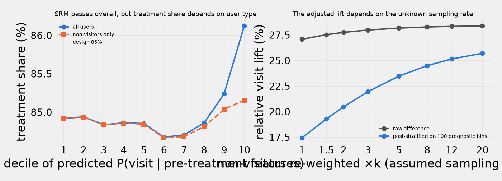

<!-- Generated by `expkit docs` from docs/templates/README.md.j2 and results/*.json. Do not edit by hand. -->
# expkit: an A/B-testing engine, and what it found in a famous 14M-user ad experiment

[](https://github.com/TonyLee-99/experimentation-platform/actions/workflows/ci.yml)
 

| | |
|---|---|
| **Problem** | Most bad experiment decisions come from trusting a result you shouldn't: a sample-ratio check that passed, daily peeking, a "winning" lift inflated by selection. Central experimentation teams build platforms to catch these before a launch decision. |
| **What I built** | A warehouse-native A/B-testing engine: metrics defined once in YAML and compiled to DuckDB SQL; Welch, delta-method, CUPED and cross-fitted CUPAC estimators; SRM and covariate-balance gates; mSPRT and O'Brien–Fleming sequential tests; empirical-Bayes shrinkage; IV estimates for non-compliance; uplift models; and an automated SHIP / HOLD scorecard with a generated readout. |
| **Key results** | Found an assignment imbalance (z = 33) in Criteo's 14M-user ad experiment that the standard SRM check misses, so the scorecard returns HOLD instead of SHIP. 10,000 A/A tests on 2.1M real users keep false positives at 4.6–5.4%. On 361 real ASOS experiments, O'Brien–Fleming cut sign reversals from 33 to 4. CUPAC cut visit-metric variance by 30.8%. |
| **Stack** | Python, SQL (DuckDB), LightGBM, scipy / statsmodels, pytest + Hypothesis (property and cross-check tests), GitHub Actions |

## The story: SRM passed, but the platform says HOLD

Criteo's public ad-incrementality test (13,979,592 users) splits treatment/control at exactly
0.85000 / 0.15000, so the
sample-ratio check passes (p = 0.999). A naive dashboard reports conversions
**+59.4%** and says ship.



1. **The arms are not exchangeable.** Pre-treatment features predict assignment: a classifier two-sample test on
   6,990,238 held-out users gives AUC 0.50997 (z = 33), and
   a joint χ² on the 12 feature means is 5,945 on 12 df. Treatment share is flat at
   84.9% in deciles 1–8 of predicted visit propensity and rises to
   86.1% in the top decile (left panel).
2. **Two documented causes are possible, and they disagree about the fix.** The dataset paper (Diemert et al. 2021,
   §3) says each pooled advertiser test was re-sampled to 85% treatment, *and* that "non-uniform negative sampling on
   labels" was applied. Re-balancing residue would be fixed by adjusting for features. Sampling on the outcome would not:
   it only preserves odds ratios. The data fit neither story alone. Among *non-visitors* the treatment share still rises,
   from 84.82% to
   85.16%. Pure outcome sampling cannot produce that *if ads never
   lower visit propensity*. The evidence is one decile (z = 4.1 vs 85%;
   decile 9 is z = 1.2).
3. **So the size of the effect is not identified from the released data.** Feature-adjusted estimates of the
   conversion lift range from +46.0% (CUPAC) to +47.3%
   (CUPED). Re-weighting non-visitors ×1 to ×20, to undo an unknown negative-sampling rate, moves the post-stratified lift
   from +46.8% to
   +59.8% if visits were the sampled label (right panel; visits:
   +17.4% to +25.7%). If
   conversions were the sampled label, it is only +46.8% to
   +50.0%. The upper end is essentially the raw estimate. None of
   these levels is a plausible real ad effect: Criteo distorted them on purpose so "the original incrementality level
   cannot be deduced".
   On the odds-ratio scale, which outcome-dependent sampling does not distort, the crude vs stratified
   (Mantel–Haenszel) gap is small for visits (1.285 vs
   1.261) and moderate for conversions (1.596 vs
   1.474).
4. **The direction is robust, the magnitude is not.** Every estimator and every sensitivity scenario says the effect is
   positive and significant. The scorecard therefore stops at rule R1b, **HOLD — balance check failed**: a failed balance check is
   treated like an SRM, not as a warning to switch estimators. The memo recommends keeping the campaign on while the
   assignment is investigated, and not budgeting on any single number ([decision memo](docs/decision_memo.md)).

A synthetic test (`tests/test_selection_on_outcome.py`) shows the mechanism. It randomizes a treatment, then keeps
only 20% of the non-converters. That creates exactly this kind of feature imbalance, and X-adjustment misses the true lift
badly. The Mantel–Haenszel odds ratio recovers the true *odds ratio*. The *lift* is recovered only by re-weighting with
the known keep rate, which the released data do not provide.

## Three headline numbers

| | Result | Source |
|---|---|---|
| Assignment check | SRM p = 0.999 (passes); balance χ² = 5,945 on 12 df (fails) → **HOLD**; conversion lift +46.8% to +59.8% across sampling scenarios | `results/balance.json`, `results/scorecard_criteo.json` |
| Calibration on real units | 10,000 A/A re-randomizations of 2,096,937 real control users: false-positive rate 4.6%–5.0% (50/50) and 4.6%–5.4% (85/15) for Welch, CUPED, CUPAC and delta-method tests | `results/aa_tests*.json` |
| Peeking on real experiments | On 361 real ASOS trajectories, daily peeking flagged 218 as significant and reversed sign 33 times. A Brownian model fitted to the same portfolio expects 163 flags and 9 reversals. O'Brien–Fleming cut reversals to 4, but it also crossed 136 times vs 100 expected (1.36×, about the same excess as naive peeking's 1.34×). Real experiments drift more than textbook simulations assume | `results/asos_portfolio.json` |

## What the platform does

- **Metric layer.** Metrics are defined once in YAML (`metrics/criteo.yaml`) and compiled to DuckDB SQL that returns
  only per-variant sums (n, Σy, Σy², Σy³, Σx, Σxy, Σxxᵀ). 14M rows become a handful of numbers. CUPED, the delta method,
  balance checks and sequential looks all run from those sums.
- **Decision rules, in order.** R1 SRM → BLOCKED · R1b balance → HOLD · R2/R3 guardrails → NO-SHIP/HOLD ·
  R4–R6 primary metric with BH correction. Each readout also shows the decision under every estimator, a break-even
  table, and what a naive dashboard would have said.
- **Readouts.** `expkit analyze --config experiments/<name>.yaml` writes HTML:
  - [Criteo](reports/criteo_readout.html): HOLD — balance check failed (R1b).
  - [ASOS d53f0e](reports/asos_d53f0e_readout.html), a hard call: daily peeking flagged a win on day
    7; after 47 days the primary
    metric is +0.42% (p = 0.057) and two guardrails are not yet
    within margin → **HOLD**, while the expected-loss rule says ship.
  - [Simulated logging bug](reports/criteo_srm_bug_readout.html): BLOCKED — SRM.
- **Before launch:** a one-page [experiment brief](docs/experiment_brief.md) (hypothesis, metrics, MDE, runtime, stopping rule).

## Results at a glance

| Question | Answer |
|---|---|
| Variance reduction (CUPAC, 2-fold cross-fitted LightGBM) | conversions 12.9% (linear CUPED 10.7%); visits 30.8% (25.2%) |
| Per exposed user (one-sided non-compliance, 3.60% of treated users exposed) | conversions 2.50 pp and visits 18.3 pp (2SLS with the CUPAC covariate; Wald on the CUPAC-adjusted ITT gives 2.47 pp / 17.6 pp; the unadjusted Wald gives 28.7 pp for visits). Sharp IV inequalities: 0 of 40 violated. Levels inherit Criteo's sampling distortion |
| Ghost-ads triggering would need | 8.1× fewer users for visits, 2.3× for conversions |
| Winner's curse (99 ASOS treatments) | a reported +0.6% win on metric 1 is really about +0.33% (discrete NPMLE prior) to +0.57% (normal prior), so forecast winners with a range, not a rule. The NPMLE is lumpy: on the same metric a +1.0% result moves *up* to +1.36% |
| Ship-rule policy (ASOS metric 1, scored under the NPMLE truth model) | the p-value rule ships 16 with 0.7 expected harmful launches; a fixed 0.1% expected-loss rule ships 66 with 25.1 |
| Targeting (top 20% by conversion uplift, shared denominator) | 81%–87% of incremental conversions depending on adjustment (unweighted / IPW, which assumes selection on observables) on 69.1% of exposures. A plain response model does better here: 95.0% on 73.5% (IPW) |

Details, methods and every other table are in the [appendix](docs/appendix.md). Acceptance criteria and their
PASS/FAIL status, including the misses, are in [`docs/ACCEPTANCE.md`](docs/ACCEPTANCE.md).

## How to run

```bash
make all       # setup → download (~0.3 GB) → CUPAC → lint → tests → validation → readouts → figures → docs → acceptance
make quick     # lint, tests, readouts, docs and acceptance from cached results (minutes)
.venv/bin/expkit analyze --config experiments/criteo.yaml
.venv/bin/expkit validate balance   # or: aa | asos | noncompliance | heavy | hte | crosscheck | all
```

Python 3.12 (uv), dependencies pinned in `pyproject.toml`. A `Dockerfile` and `.github/workflows/ci.yml` are
included, not run. Every number in this README is rendered from `results/*.json` by `expkit docs`, and
`tests/test_docs_drift.py` fails if any of them drift.

## Data

| Dataset | Rows | Link | License |
|---|---|---|---|
| Criteo Uplift v2.1: features f0–f11, assignment, exposure, visit, conversion | 13,979,592 | [HF `criteo/criteo-uplift`](https://huggingface.co/datasets/criteo/criteo-uplift), [paper](https://arxiv.org/abs/2111.10106) | CC BY-NC-SA 4.0 |
| ASOS Digital Experiments: 78 experiments, 99 treatments, 4 metrics, cumulative snapshots | 24,153 | [OSF 64jsb](https://osf.io/64jsb/) | CC BY 4.0 |
| Hillstrom MineThatData email RCT (heavy-tail study, appendix) | 64,000 | [minethatdata.com](http://www.minethatdata.com/blog/2008/03/minethatdata-e-mail-analytics-and-data.html) | public challenge data |

Simulation is used only for validation and is labeled in every output: re-randomizing real units, injecting known
effects, or model-based paths on real look schedules.

## Known limitations

- The Criteo effect size is only partially identified (story above). The sensitivity grid assumes a *uniform*
  negative keep-rate, whereas the paper says the sampling was non-uniform. Absolute incrementality is also distorted on
  purpose by Criteo's privacy sub-sampling.
- Criteo has no timestamps, no cost data and no harm metrics. The readout shows the sequential panel as N/A, uses
  assumed prices for the break-even table, and has no guardrail.
- ASOS publishes cumulative per-user metrics with no ground truth. Peeking "errors" on real trajectories are judged
  against the final analysis and against a fitted model, not against truth. The trajectory filter is
  396 → 381
  (valid variances, ≥ 2 daily looks) → 361 (≥ 3 looks).
  Treatments sharing a control are treated as independent.
- The mSPRT mixing scale and the expected-loss prior come from the same ASOS portfolio they are evaluated on. In
  production they would be fitted on past experiments.
- The conversion CUPAC model was re-tuned once after missing its 15% variance-reduction target. It still misses
  (ACCEPTANCE V4).
- There are no interference, novelty or long-term holdout models.
