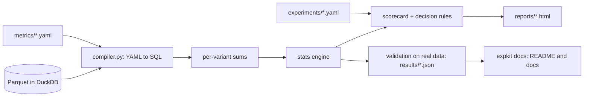
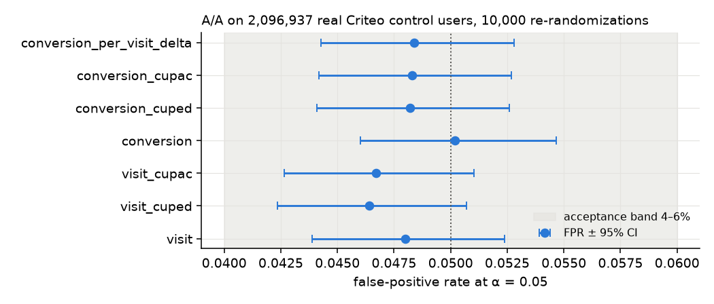
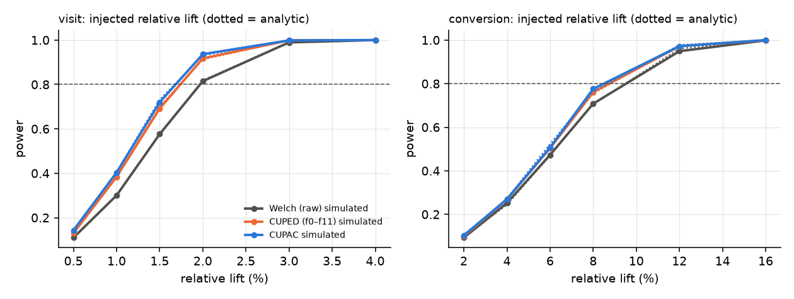
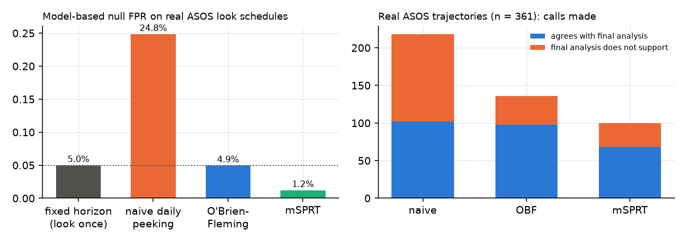
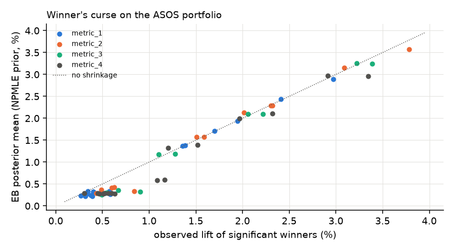
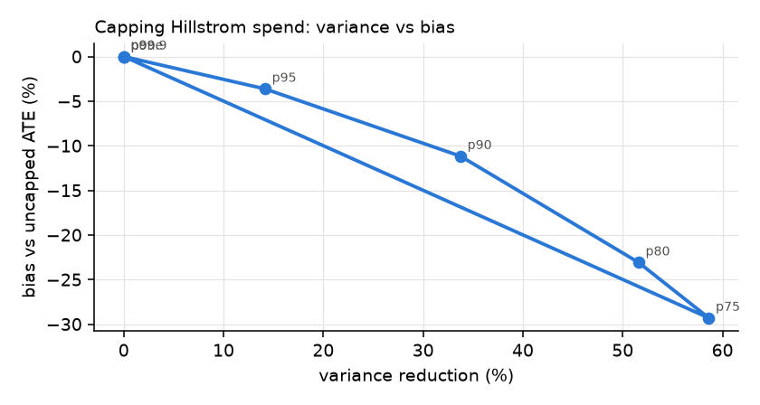

<!-- Generated by `expkit docs` from docs/templates/appendix.md.j2 and results/*.json. Do not edit by hand. -->
# Appendix: methods, validation and every other result

## A. Architecture

Packages: `metrics` (catalog + SQL compiler) · `stats` (Welch, delta, CUPED/CUPAC, SRM, BH, mSPRT, Lan–DeMets GSD,
Poisson bootstrap, power, expected loss, empirical Bayes, Wald/2SLS) · `validation` (A/A, power, peeking, cross-checks,
acceptance) · `analyses` (CUPAC, balance forensics, ASOS portfolio, non-compliance, heavy tails, HTE) · `hte` ·
`report` · `decision.py` · `docs.py` · `cli.py`.

## B. The engine against external references (real Criteo rows)

| Check | Max difference |
|---|---|
| Welch from SQL sums vs `scipy.stats.ttest_ind`, 13.98M rows | stat 0e+00, SE 4e-16 |
| Delta-method SE vs statsmodels cluster-robust OLS | 8e-15 |
| CUPED (SQL, 12 covariates) vs statsmodels θ + scipy Welch | stat 7e-09; θ 7e-06; vs ANCOVA estimate 0.04% |
| Wald CACE / SE vs `linearmodels` IV2SLS | 2e-10 / 8e-12 |
| SRM vs `scipy.stats.chisquare`; BH vs statsmodels | 0; 3e-17 |
| Lan–DeMets boundaries vs independent `gsdesign` integration; Jennison–Turnbull constants; near-duplicate looks | tests in `tests/test_crosscheck.py` |
| Own Qini curve vs `causalml.metrics.get_qini` (300k holdout users, identical tie-breaking) | 0 |

The group-sequential integrator propagates the null density with cell-integrated (CDF-difference) transitions. An
earlier point-sampled kernel broke on real ASOS schedules with near-duplicate looks, which `test_obf_type1_with_near_duplicate_looks` now guards.

## C. Calibration and power on real units (simulation on real data)

| method / metric | FPR 50/50 (10,000 reps) | FPR 85/15 (10,000 reps) | KS p (50/50) |
|---|---|---|---|
| visit | 4.80% | 5.14% | 0.675 |
| visit_cuped | 4.64% | 5.09% | 0.226 |
| visit_cupac | 4.67% | 5.38% | 0.729 |
| conversion | 5.02% | 4.77% | 0.674 |
| conversion_cuped | 4.82% | 4.73% | 0.583 |
| conversion_cupac | 4.83% | 4.82% | 0.731 |
| conversion_per_visit_delta | 4.84% | 4.63% | 0.403 |

A/A tests validate the *variance* of each estimator. They cannot validate the real assignment mechanism, because the
re-randomization creates balance by construction. Bootstrap A/A on 20,000-user subsamples
(1000 reps): visit 4.9%, conversion
4.9%.

Injected effects (2,000 reps per point): empirical Welch power is within
1.2 pp of the analytic formula at every point. Interpolated 80%-power MDE for visits: raw
1.97%, CUPED 1.74%, CUPAC 1.68%. For conversions: raw
9.53%, CUPAC 8.49%. Injected flips are independent of the features, so
the CUPED/CUPAC gain shown here is conservative.

## D. Sequential testing on ASOS

ASOS metrics accumulate per user (means grow and variances roughly double over a test), so information is not
proportional to n. All sequential analyses use the relative lift with **variance-based information**,
I_k = 1/Var(relative lift). The largest gap between n-based and variance-based fractions has median
0.10 per trajectory.

**Model-based null** (Brownian information-time model on the real look schedules; OBF ≈ 5% holds by construction):
naive daily peeking 24.8%, OBF 4.94%, mSPRT 1.21%, one look
4.98%. mSPRT is conservative because Ville's bound is built for unlimited looks; it wastes
α with about 39 looks.

**Real trajectories vs the same model** (361 trajectories, 105 significant at the end):

| | real: declared | real: final does not support | real: sign reversals | real: final significant, opposite sign | detects final-significant |
|---|---|---|---|---|---|
| naive daily p < 0.05 | 218 | 116 | 33 | 3 | 97% |
| O'Brien–Fleming | 136 | 38 | 4 | 0 | 93% |
| mSPRT | 100 | 32 | 9 | 2 | 65% |
| *naive, model expectation (true effects from the fitted NPMLE prior)* | 163 | 61 | 9 | | |
| *naive, model expectation (pure null)* | 92 | 73 | 12 | | |
| *OBF, model expectation (true effects from the fitted NPMLE prior)* | 100 | 5 | 0.0 | | |

"Final does not support" is not the same as "false positive". In the model, about
26 of the 61 unsupported naive
calls are real effects (|lift| > 0.1%, right sign) that the final test failed to confirm. The interesting result is the
excess: the real portfolio crosses and reverses far more often than the model allows. That is consistent with
non-Brownian dynamics (novelty, weekly cycles, telemetry spikes), and it means the real naive error rate is
plausibly above the model's 24.8%. OBF is not immune: it crossed 136 times vs
100 expected (1.36×, about the same relative excess as naive
peeking's 1.34×). It reversed 4 times vs ≈0.0 expected. So OBF
cuts reversals sharply, but its boundaries are not validated on drifting real metrics. The final look is always
treated as an information look: when information fell at the end, earlier looks above the final information are
dropped, so the last boundary is evaluated on the final day.

**Stopping time, compared fairly.** On the 68 trajectories that
both mSPRT and OBF detect, the median stop is day 11.5 (mSPRT) vs day
13 (OBF), with a median horizon of 45 days. mSPRT stops a
little earlier on the effects it catches, but it catches far fewer.

Criteo control users in a simulated random arrival order (2,000 A/A reps ×
24 looks): naive 27.0%, OBF 5.60%,
mSPRT 0.85%.

## E. Winner's curse and empirical Bayes (ASOS as an experiment portfolio)

| metric | sig. winners | ratio of means | small winners (<1%) median overstatement | FDR among winners: normal / NPMLE | P(true lift > +0.1%) [90% bootstrap CI] | excess kurtosis [90% CI] | normal-EB coverage among winners, fat-tailed truth |
|---|---|---|---|---|---|---|---|
| 1 | 16 | ×1.09 | ×1.34 (10) | 0.6% / 4.4% | 23% [12%, 39%] | 8.2 [4.2, 16.0] | 85% |
| 2 | 12 | ×1.06 | ×1.48 (5) | 0.3% / 4.5% | 19% [12%, 43%] | 6.8 [3.0, 12.1] | 84% |
| 3 | 12 | ×1.14 | ×1.85 (6) | 0.7% / 1.2% | 28% [15%, 64%] | 6.9 [3.3, 13.9] | 84% |
| 4 | 16 | ×1.21 | ×1.81 (8) | 0.8% / 2.6% | 43% [30%, 58%] | 5.1 [2.0, 10.4] | 85% |

**PM haircut**: posterior mean for a result reported at the metric's median SE, under the discrete NPMLE prior and
under the normal prior.

| metric | reported +0.3% | reported +0.6% | reported +1.0% | reported +2.0% |
|---|---|---|---|---|
| 1 | +0.22% (NPMLE) / +0.29% (normal) | +0.33% (NPMLE) / +0.57% (normal) | +1.36% (NPMLE) / +0.95% (normal) | +1.91% (NPMLE) / +1.89% (normal) |
| 2 | +0.14% (NPMLE) / +0.29% (normal) | +0.39% (NPMLE) / +0.57% (normal) | +0.64% (NPMLE) / +0.94% (normal) | +2.13% (NPMLE) / +1.88% (normal) |
| 3 | +0.15% (NPMLE) / +0.28% (normal) | +0.29% (NPMLE) / +0.55% (normal) | +0.96% (NPMLE) / +0.91% (normal) | +2.09% (NPMLE) / +1.82% (normal) |
| 4 | +0.19% (NPMLE) / +0.27% (normal) | +0.28% (NPMLE) / +0.54% (normal) | +0.88% (NPMLE) / +0.90% (normal) | +1.98% (NPMLE) / +1.78% (normal) |

Quote these as a range: on metric 1, a reported +0.6% is about +0.33% to
+0.57%. The NPMLE prior is a handful of atoms, so its posterior mean is lumpy.
Results between two atoms are pulled to the nearest one, which can even move a result *up* (+1.0% → +1.36% on
metric 1). The bootstrap over prior refits covers resampling noise only, not this model choice. A smoothed g-model
(Efron 2016) would be needed before quoting any single number as a rule.

Notes. The NPMLE log-likelihood is always at least the normal one because the NPMLE nests it, so it is not evidence of
non-normality. The fat-tail reading rests on the fitted shape and its (wide) bootstrap intervals. 0.1% is below the
median SE, so the mass around ±0.1% is weakly identified. Under a self-consistent simulation, normal-EB intervals cover
95.0% overall (metric 1). Under a fat-tailed truth, coverage among winners drops to
84%–85%.

**Ship rules as portfolio policies** (metric 1; every rule scored under the NPMLE posterior as the truth model;
utility = Σ(posterior mean − launch cost) over shipped treatments, in relative-lift units):

| rule | ships | negative posterior mean | expected harmful launches | expected total lift | EV at cost 0.05% / launch | EV at cost 0.1% / launch |
|---|---|---|---|---|---|---|
| p_value (p<0.05, positive) | 16 | 0 | 0.7 | 0.145 | 0.137 | 0.129 |
| expected loss < 0.1% (fixed eps) | 66 | 14 | 25.1 | 0.168 | 0.135 | 0.102 |
| expected loss < 0.01% (fixed eps) | 26 | 0 | 3.8 | 0.156 | 0.143 | 0.130 |
| expected loss < 0.1 x median SE (eps tied to SE) | 31 | 0 | 5.8 | 0.161 | 0.145 | 0.130 |
| posterior mean > 0 | 56 | 0 | 18.4 | 0.172 | 0.144 | 0.116 |
| P(theta>0) > 0.95 (NPMLE) | 10 | 0 | 0.0 | 0.130 | 0.125 | 0.120 |

With a fixed ε = 0.1%, which is below the median SE (0.15%), the expected-loss rule ships
treatments whose sign is unknown. It buys a little more total lift for many more expected harmful launches, and it is
dominated as soon as launches cost anything. Which rule is best depends on the launch cost, so ε should be tied to the SE
and to that cost, not fixed.

## F. Non-compliance (Criteo `treatment` vs `exposure`)

| | visit | conversion |
|---|---|---|
| compliance (exposed share of treated; 0 exposed controls) | 3.60% | 3.60% |
| **CACE, 2SLS with CUPAC covariate (headline)** | 18.3 pp ± 0.7 pp | 2.50 pp ± 0.18 pp |
| Wald on the CUPAC-adjusted ITT | 17.6 pp | 2.47 pp |
| 2SLS with f0–f11 | 21.5 pp | 2.82 pp |
| unadjusted Wald (uses the raw ITT; reference only) | 28.7 pp | 3.20 pp |
| complier means E[Y(1)], E[Y(0)]; never-taker mean | 41.5%, 12.8%; 3.5% | 5.38%, 2.18%; 0.12% |
| sharp IV inequalities (Kitagawa 2015), 10 deciles × 2 | 0 violated (max z -0.21) | 0 violated (max z 0.38) |
| users needed, ITT vs ideal trigger (85/15-weighted; unweighted) | 8.1× (7.0×) | 2.3× (2.2×) |

**Retargeting caveat.** Exposure is logged over the same window as the outcome, and visiting the site makes a user
eligible for retargeting. So compliers are partly selected on outcome behaviour: their baseline visit rate
(12.8%) is 3.3× the control mean.
The CACE is a valid ratio of ITTs for this population, but not "the effect of an ad opportunity". Ghost ads log the
counterfactual first opportunity for exactly this reason.

**Predicted trigger.** Keeping only the top-k users by predicted exposure and diluting back is biased, because the cut
users still carry exposures. The unbiased use is stratification over predicted-exposure deciles:
ITT 0.82 pp (SE ×0.99 vs unstratified).
That is effectively another X-adjustment, with little precision gain here.

## G. HTE and targeting (train on 6,989,354 users, evaluate on 6,990,238 held-out users)

| ranking score | visits: Qini coefficient (standard) | visits: area above random / total (non-standard) [95% CI] | conversions: Qini coefficient | conversions: area above random / total |
|---|---|---|---|---|
| x_learner | 0.091 | 0.371 [0.352, 0.388] | 0.161 | 0.353 |
| t_learner | 0.086 | 0.352 [0.335, 0.370] | 0.125 | 0.274 |
| response_model | 0.085 | 0.346 [0.340, 0.353] | 0.185 | 0.406 |
| exposure_propensity | 0.091 | 0.369 | 0.170 | 0.374 |
| random | 0.001 | 0.003 [-0.006, 0.016] | -0.001 | -0.002 |

The standard Qini coefficient (Radcliffe) is normalized by the perfect curve. The second column is the area between
the curve and the random line divided by the total increment: it is not comparable to published Qini values, and its
maximum is about 0.5.

**Targeting** (IPW increments; every ranking uses the same denominator, the IPW increment over the whole holdout;
exposure share = share of exposed treated users; efficiency = increment share / exposure share; 90% bootstrap CIs):

| outcome, ranking | top | share of increment [90% CI] | share of exposures | efficiency [90% CI] | tail marginal efficiency |
|---|---|---|---|---|---|
| conversions, conversion_x_learner | 10% | 82.0% [79.1%, 86.0%] | 53.0% | 1.55 [1.49, 1.62] | 0.38 |
| conversions, conversion_x_learner | 20% | 87.4% [85.1%, 90.6%] | 69.1% | 1.26 [1.23, 1.31] | 0.41 |
| conversions, conversion_x_learner | 30% | 89.3% [86.9%, 92.2%] | 75.1% | 1.19 [1.16, 1.23] | 0.43 |
| conversions, conversion_x_learner | 50% | 91.4% [89.2%, 93.7%] | 80.5% | 1.13 [1.11, 1.16] | 0.44 |
| conversions, visit_x_learner | 10% | 80.1% [77.2%, 83.9%] | 61.7% | 1.30 [1.25, 1.36] | 0.52 |
| conversions, visit_x_learner | 20% | 90.0% [86.8%, 94.0%] | 78.5% | 1.15 [1.11, 1.20] | 0.47 |
| conversions, visit_x_learner | 30% | 91.9% [88.9%, 95.4%] | 86.5% | 1.06 [1.03, 1.10] | 0.60 |
| conversions, visit_x_learner | 50% | 92.7% [89.7%, 96.3%] | 91.7% | 1.01 [0.98, 1.05] | 0.88 |
| conversions, conversion_response_model | 10% | 87.4% [83.9%, 90.2%] | 55.6% | 1.57 [1.51, 1.62] | 0.28 |
| conversions, conversion_response_model | 20% | 95.0% [92.8%, 96.8%] | 73.5% | 1.29 [1.26, 1.32] | 0.19 |
| conversions, conversion_response_model | 30% | 96.9% [95.2%, 98.2%] | 81.9% | 1.18 [1.16, 1.20] | 0.17 |
| conversions, conversion_response_model | 50% | 98.0% [97.0%, 99.0%] | 94.0% | 1.04 [1.03, 1.05] | 0.33 |
| conversions, exposure_propensity | 10% | 77.9% [73.2%, 81.3%] | 72.0% | 1.08 [1.02, 1.13] | 0.79 |
| conversions, exposure_propensity | 20% | 87.7% [84.6%, 90.6%] | 87.8% | 1.00 [0.96, 1.03] | 1.01 |
| conversions, exposure_propensity | 30% | 95.0% [93.2%, 97.0%] | 93.5% | 1.02 [1.00, 1.04] | 0.76 |
| conversions, exposure_propensity | 50% | 98.1% [97.3%, 99.1%] | 97.6% | 1.01 [1.00, 1.01] | 0.79 |
| visits, visit_x_learner | 10% | 79.3% [76.3%, 82.1%] | 61.7% | 1.29 [1.24, 1.33] | 0.54 |
| visits, visit_x_learner | 20% | 91.0% [88.6%, 93.8%] | 78.5% | 1.16 [1.13, 1.19] | 0.42 |
| visits, visit_x_learner | 30% | 93.8% [91.6%, 96.0%] | 86.5% | 1.08 [1.06, 1.11] | 0.46 |
| visits, visit_x_learner | 50% | 96.9% [95.2%, 98.9%] | 91.7% | 1.06 [1.04, 1.08] | 0.38 |
| visits, conversion_x_learner | 10% | 67.7% [65.6%, 70.9%] | 53.0% | 1.28 [1.24, 1.34] | 0.69 |
| visits, conversion_x_learner | 20% | 80.3% [77.8%, 82.6%] | 69.1% | 1.16 [1.13, 1.20] | 0.64 |
| visits, conversion_x_learner | 30% | 84.4% [82.2%, 86.6%] | 75.1% | 1.12 [1.09, 1.15] | 0.63 |
| visits, conversion_x_learner | 50% | 88.1% [86.4%, 89.8%] | 80.5% | 1.09 [1.07, 1.12] | 0.61 |

Without propensity weights, the conversion X-learner's top 20% keeps 80.6% (vs
87.4% with IPW). The IPW weights come from the same propensity model that shows imbalance, so they assume
selection on observables. Quote the targeting gain as a range.

The uplift and response rankings both concentrate the increment where ads are actually served. On conversions the
response model beats the uplift models (standard Qini 0.185 vs
0.161). Cutting the tail assumes exposures do not re-allocate after re-targeting,
which a holdout test would have to confirm.

## H. Heavy tails: capping Hillstrom spend

| cap (buyer-spend quantile) | threshold | variance reduction | bias vs uncapped ATE | MSE | power (n = 16k, simulation) |
|---|---|---|---|---|---|
| none | none | 0% | +0.0% | 0.0127 | 73% |
| p75 | $153 | 59% | -29.3% | 0.0358 | 82% |
| p80 | $178 | 52% | -23.1% | 0.0251 | 83% |
| p90 | $256 | 34% | -11.2% | 0.0128 | 82% |
| p95 | $362 | 14% | -3.6% | 0.0113 | 77% |
| p99 | $499 | 0% | +0.0% | 0.0127 | 73% |
| p99.9 | $499 | 0% | +0.0% | 0.0127 | 73% |

The bias is measured against a noisy uncapped estimate from the same sample, so the MSE ranking between nearby caps is
not stable. The defensible statement is that a cap between p90 and p95 trades a little bias for substantial variance.
Capping changes the estimand: report both versions. Caps at p99 and above do nothing, because the source already tops out at
$499.

## I. The hard call: ASOS experiment d53f0e

Daily peeking flagged a win on day 7. After 47 days, metric 1 is
+0.42% (95% CI -0.01% to +0.85%). The two
guardrails are -0.14% and -0.15%, and neither is proven within the −0.5% margin. The
framework says **HOLD** (R3); the expected-loss rule says **ship**
(P(effect > 0) = 0.963). OBF and mSPRT never crossed. See `reports/asos_d53f0e_readout.html`
for the readout and the five-line PM note.

## J. How this maps to production, and references

- Warehouse-native metric layers and stats from sufficient statistics: Eppo, Statsig Warehouse Native, Netflix XP.
- CUPED: Deng, Xu, Kohavi & Walker (2013, WSDM). CUPAC: DoorDash Engineering (2020). Regression adjustment: Lin (2013).
- SRM: Kohavi, Tang & Xu (2020), *Trustworthy Online Controlled Experiments*, ch. 21; Fabijan et al. (2019, KDD).
  Pitfalls: Dmitriev et al. (2017, KDD, "A Dirty Dozen"); Kohavi et al. (2012, KDD, "Five Puzzling Outcomes").
- Delta method: Deng, Knoblich & Lu (2018, KDD).
- Sequential: Johari et al. (2017 KDD; 2022 Operations Research); Lan & DeMets (1983); Jennison & Turnbull (2000);
  Spotify Engineering (2023) "Choosing a Sequential Testing Framework"; Netflix Tech Blog on sequential A/B testing.
- Triggering and non-compliance: Deng & Hu (2015, WSDM); Kohavi et al. (2020) ch. 20; Johnson, Lewis & Nubbemeyer
  (2017, JMR, "Ghost Ads"); Gordon et al. (2019, Marketing Science); Angrist, Imbens & Rubin (1996); Kitagawa (2015,
  Econometrica).
- Winner's curse and priors: Lee & Shen (2018, KDD); Azevedo et al. (2020, JPE, "A/B Testing with Fat Tails"); Deng
  (2015, WWW); Koenker & Mizera (2014); Efron (2016).
- Decisions: Stucchio (2015, VWO); Schultzberg et al. (2024, Spotify).
- Bootstrap: Chamandy et al. (2012, Google); Kohavi, Deng, Longbotham & Xu (2014, KDD, "Seven Rules of Thumb").
- Uplift: Künzel et al. (2019, PNAS); Radcliffe (2007); Diemert et al. (2021).
- Dataset construction: Diemert et al. (2021, arXiv:2111.10106) §3 and Table 3, where the permutation C2ST
  (300 permutation draws; classifier log-loss 0.42307 vs constant 0.42269, p = 0.137) did not reject.
